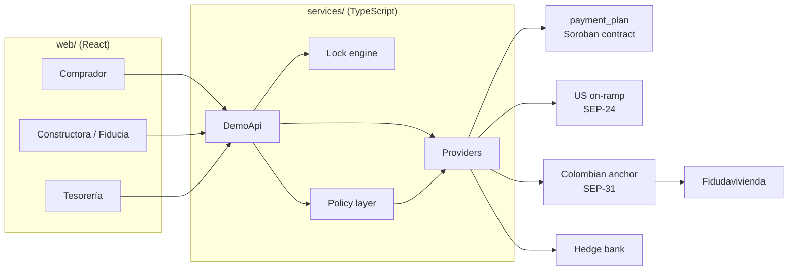
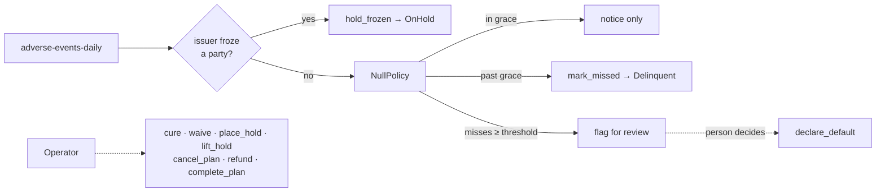

# Casa Puente

Casa Puente lets a Colombian buyer living in the United States pay the down-payment installments on a Constructora Bolívar home from a US bank account, in one screen, at a dollar amount that Bolívar guarantees for the next one or three installments. The pesos land in the buyer's encargo fiduciario at Fidudavivienda and reconcile automatically, while Bolívar's treasury sees the forward hedge (booked with Davivienda) behind every guaranteed rate. The rail is Stellar: USDC, a Soroban contract that holds each plan's balance and schedule, and SEP anchors for the US on-ramp and the Colombian payout.

**Status:** Stage 3. The `payment_plan` contract (soroban-sdk 29.0.1, protocol 29, schema v2) adds adverse-event governance: delinquency, default, holds, cancellation with refunds only to the buyer, an admin pause, and a typed `AssetFrozen` error with a permissionless `hold_frozen` for an issuer freeze. The service layer adds a policy seam that applies only the grace and missed rules and records everything else for a person; the open business decisions are listed in [docs/ADVERSE_EVENTS.md](docs/ADVERSE_EVENTS.md).

**How to run it:** see [docs/RUNNING.md](docs/RUNNING.md). Contract reference: [docs/CONTRACT.md](docs/CONTRACT.md).

**Testnet deployment:** contract [`CAVPFFH4WFPHI3525RFM7AOGUXOP3USLCN6IPOF7AK5PMNAGQAJCCTXP`](https://stellar.expert/explorer/testnet/contract/CAVPFFH4WFPHI3525RFM7AOGUXOP3USLCN6IPOF7AK5PMNAGQAJCCTXP) on Stellar testnet, running Wasm `a28d240c3728f3415b73218597bb4b9f23c77384c4d7beda77a57300e88755b1` (schema v2). It is **one version behind this branch**: the code here builds Wasm `8d2a440260ae26ad2ebe15abb91180208f631bd37d5dfe219f17c666bd3899ad`, which adds the typed `AssetFrozen` error and `hold_frozen`. The upgrade is blocked by testnet itself: the network's Soroban state is above its target size, so rent on a new Wasm entry is steep and the upload needs about 738 XLM in fees, more than the 429.5 XLM one transaction can carry (measured 2026-10-25). Shrinking the Wasm barely moves that fee. `npm run deploy:testnet` reports this and keeps the running contract; rerun it when the fee falls below the limit. Everything else on testnet (plans, payments, the adverse functions of schema v2) runs on the deployed version.

## Architecture



Every external dependency is an interface with a mock and a testnet implementation, so the same UI runs on mocks or on Stellar testnet. Details: [docs/ARCHITECTURE.md](docs/ARCHITECTURE.md).

## Money flow

```mermaid
sequenceDiagram
  participant Buyer as Buyer (US bank)
  participant On as US on-ramp
  participant PP as payment_plan
  participant Payee as Payee backend
  participant Off as CO anchor
  participant Fid as Fidudavivienda
  Buyer->>On: ACH, USD
  On->>Buyer: USDC
  Buyer->>PP: deposit
  PP->>Payee: release at the locked rate (or at spot)
  Payee->>Off: SEP-31, USDC
  Off->>Fid: COP to the encargo, reconciled
```

The contract can pay only two addresses: the payee backend (a release) and the plan's buyer (a refund or the leftover at completion).

## Lock flow

1. The buyer chooses Mensual or Trimestral for the next open installments.
2. The lock engine prices it: `locked_rate = spot + pass_through × (avg_fwd − spot)`; `usd_due = cop_due / locked_rate`.
3. The quote is valid 10 minutes and must be accepted 3 business days before the first installment.
4. On acceptance the operator and the buyer sign `apply_lock`; the contract stores the rate (× 1e7) and `usd_due` in stroops, and treasury books the matching NDF legs.
5. Unpaid after 5 business days of grace, the lock breaks (`Broken`) and the installment is paid at spot; the break cost is the negative mark-to-market of that leg.

## Adverse-event flow



Each transition carries a reason code and a SHA-256 evidence hash, emits a contract event and writes one `policy_events` row. Buyers see plain-Spanish notices (late, missed, on hold, defaulted, cancelled) with what to do next. Cases, hooks and open decisions: [docs/ADVERSE_EVENTS.md](docs/ADVERSE_EVENTS.md). Threats and mitigations: [docs/THREAT_MODEL.md](docs/THREAT_MODEL.md).

## Where things are

| What | Where |
| --- | --- |
| Contract | `contracts/payment_plan/src/lib.rs` |
| Contract tests | `contracts/payment_plan/src/test.rs` (core, lock math vectors, TTL, upgrade), `test_adverse.rs` (governance, pause, funds conservation), `test_frozen.rs` (issuer freeze) |
| Shared lock-math vectors | `contracts/test-vectors/lock_math.json` (checked by Rust and TypeScript) |
| Lock engine and its tests | `services/src/lock/engine.ts`, `engine.test.ts` |
| Policy layer and its tests | `services/src/policy/` (`adverseEvents.test.ts`, `transitions.test.ts`) |
| Demo API and views | `services/src/api/` |
| Web views | `web/src/views/` (`comprador`, `constructora`, `tesoreria`); strings in `web/src/i18n/` |
| Web tests | `web/src/tests/` (i18n parity, vocabulary, formats); `web/e2e/` (demo script, adverse states, accessibility with axe) |
| Anchors | `infra/` (simulated Colombian receiving anchor, Anchor Platform configuration) |
| Testnet run logs | `docs/demo-runs/` |
| Stellar versions and facts | `docs/STELLAR_NORMS.md` (append-only ledger) |

## Folder map

```
contracts/              Soroban workspace: payment_plan (Rust, soroban-sdk =29.0.1), shared lock-math test vectors
services/               Framework-free TypeScript domain layer
  src/domain/           Types and calendar helpers (business days, Colombian festivos)
  src/lock/             Lock engine: pricing (float + fixed point), rules, tests
  src/policy/           Adverse events: reasons, transitions, evidence, PolicyEngine, NullPolicy, daily run
  src/adapters/         Lock, hedge, on-ramp and off-ramp provider interfaces + mocks
  src/chain/            Stellar RPC client and the testnet bridge
  src/store/            Store interface and the in-memory implementation
  src/seed/             Deterministic seed, edge cases and one buyer per adverse state
  src/api/              DemoApi (the façade the web app uses) and view builders
web/                    React + Vite + TypeScript + Tailwind app
infra/                  Anchors: simulated SEP-31 receiver, Anchor Platform configuration
supabase/migrations/    Schema (not required to run the demo)
scripts/                Deploy, demo and reset scripts
docs/                   Architecture, adverse events, threat model, Stellar norms, run logs
research/               Stellar research pass (read-only)
```

## Demo script (75 seconds)

1. **Comprador**: María's calendar. M1–M3 paid, M4–M6 guaranteed, M7–M9 offered (dashed, renewal banner), M10 onward open.
2. **Asegurar el trimestre 3**: the quote shows USD 1.188,33 per installment at 3.444,427, a 10-minute countdown and the disclosures. Aceptar → M7–M9 turn guaranteed.
3. **+1 mes**, then **Pagar USD 1.188,33**: ACH confirm → Recibido · Convertido · Entregado a Fidudavivienda → receipt with the guaranteed rate vs today's rate.
4. **Tesorería**: the three new legs appear without hedge; **Reservar cobertura** books the strip with Davivienda (simulado); margin accrues.
5. **Constructora / Fiducia**: M4 appears matched to encargo FD-OLV-0142, status Conciliado.

The demo bar's **Ver como** switch shows the adverse-state buyers: Andrés (late, in grace), Luis (one installment missed, one waived), Paola (on hold for identity review), Jorge (defaulted) and Natalia (cancelled after a withdrawal, money held for refund).

## Design notes

- The lock applies only to fixed down-payment installments. The VIS house price adjusts to the SMMLV of the deed year and is never locked; the quote card says so.
- The buyer never sees crypto vocabulary; `web/src/tests/vocabulary.test.ts` enforces it.
- All money math lives in `services/src/lock/engine.ts`, in both float and the fixed-point form the contract uses (rate × 1e7 rounded half-up, USDC in stroops, floor division).
- Business-day rules (cutoff, grace, renewal) skip weekends and the Colombian festivos of 2026–2027 (`services/src/domain/holidays.ts`).
- The policy layer decides no business policy: refunds, penalties, defaults and cancellations are a person's action until the decisions in `docs/ADVERSE_EVENTS.md` are made.
- The testnet asset is a platform-issued test `USDC`, not Circle's; secrets for the demo accounts live only in the gitignored `.env.testnet`.
