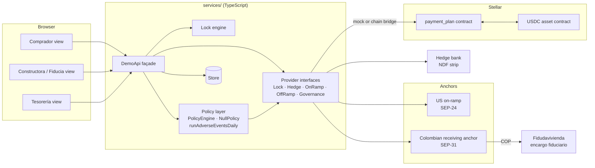
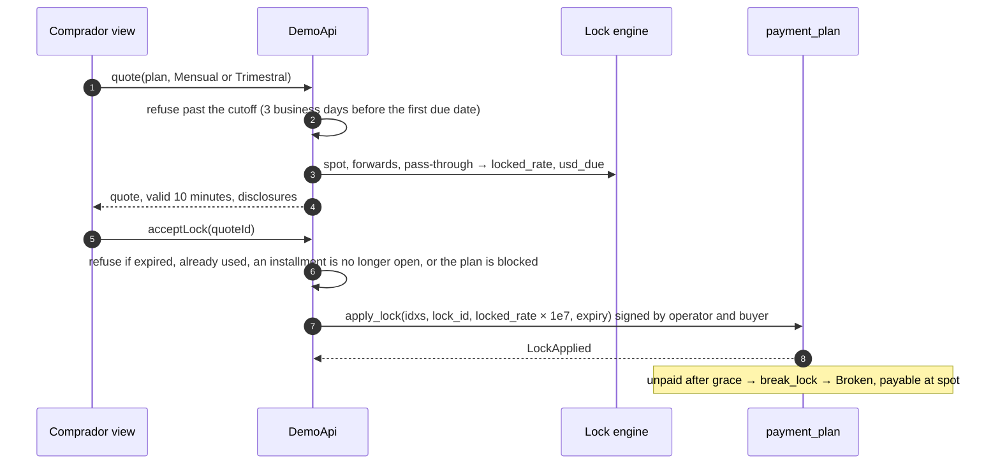
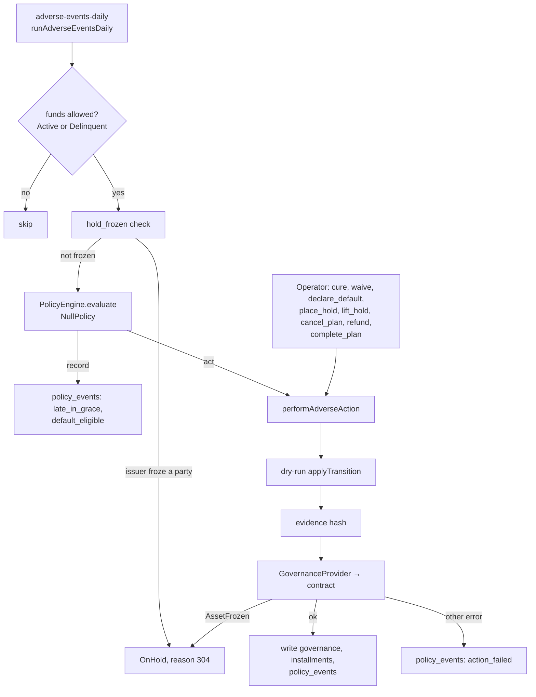

# Architecture

Casa Puente has four layers: a React app with three views, a framework-free TypeScript service layer, the `payment_plan` Soroban contract on Stellar, and the anchors that turn dollars into USDC in the US and USDC into pesos in Colombia. Every external dependency sits behind an interface, so the same UI and service code run on mocks (`DEMO_MODE=mock`) or against testnet (`DEMO_MODE=testnet`).



## Layers

| Layer | Path | Responsibility |
| --- | --- | --- |
| Web | `web/src/views/{comprador,constructora,tesoreria}` | The three views of brief §7. Every string comes from `web/src/i18n/{es,en}.json` (Spanish default, key parity tested). Buyer screens never show crypto vocabulary (`web/src/tests/vocabulary.test.ts`). |
| Façade | `services/src/api/DemoApi.ts`, `views.ts` | One object the web app calls: quotes, locks, payments, pay-ahead, the clock, reset and the read models for each view, including governance state and buyer notices. |
| Lock engine | `services/src/lock/engine.ts` | All money math: forward-points pricing, pass-through, USD per installment, break cost, business-day rules with Colombian festivos. Float form for display, fixed-point form identical to the contract (checked against `contracts/test-vectors/lock_math.json`). |
| Providers | `services/src/adapters/interfaces.ts`, `services/src/policy/GovernanceProvider.ts` | `LockProvider`, `HedgeProvider`, `OnRampProvider`, `OffRampProvider`, `GovernanceProvider`. Mock implementations add latency and share one error switch; testnet implementations call the chain or the anchors. |
| Chain | `services/src/chain/` | Soroban RPC client and the bridge that turns façade calls into `payment_plan` transactions. |
| Policy | `services/src/policy/` | Adverse events: reason codes, the TypeScript mirror of the contract's transition rules, evidence hashes, the `PolicyEngine` seam with `NullPolicy`, and the daily run. See [ADVERSE_EVENTS.md](ADVERSE_EVENTS.md). |
| Store | `services/src/store/` | `Store` interface with an in-memory implementation (persisted to `localStorage` in the browser). The Supabase schema in `supabase/migrations/` has the same tables. |
| Contract | `contracts/payment_plan/src/lib.rs` | USDC custody per plan, rate locks, releases to the payee backend, adverse-event governance, admin pause, upgrade and schema migration. |
| Anchors | `infra/` | A simulated Colombian receiving anchor (SEP-31) in Node and the Anchor Platform configuration. |

## Contract

`payment_plan` (soroban-sdk `=29.0.1`, protocol 29, schema version 2).

- **Storage.** Instance: `Config` (admin, operator, USDC asset contract, payee backend), `Version`, `Paused`. Persistent, per plan: `Plan` (buyer, count, balance), `Inst(plan, idx)` per installment, `Gov(plan)` (state, misses, hold, policy, totals). `extend_ttl` (anyone) keeps all of a plan's entries alive.
- **Roles.** Admin: `upgrade`, `migrate`, `pause`, `unpause`, `cancel_plan`. Operator: `create_plan`, `apply_lock` (with the buyer), `release_due`, `release_spot`, `break_lock`, and the adverse-event functions. Buyer: `deposit`. Anyone: `extend_ttl`, `hold_frozen` and the getters.
- **Where USDC can go.** A release pays `payee_backend` only. A refund, or the leftover at completion, pays the plan's buyer only. Nothing else transfers.
- **Errors.** Typed (`Error`, codes 1–27). A transfer refused because the issuer froze a party returns `AssetFrozen` (26), distinct from any other `TransferFailed` (15).
- **Events.** `PlanCreated`, `Deposited`, `LockApplied`, `Released`, `LockBroken`, `PauseChanged`, and one event per adverse transition carrying the reason code and evidence hash.

## Money flow

```mermaid
sequenceDiagram
  autonumber
  participant Buyer as Buyer (US bank)
  participant On as US on-ramp (SEP-24)
  participant PP as payment_plan
  participant Payee as Payee backend
  participant Off as CO anchor (SEP-31)
  participant Fid as Fidudavivienda
  Buyer->>On: ACH debit, USD
  On->>Buyer: USDC to the buyer's account
  Buyer->>PP: deposit(plan, amount)
  Note over PP: balance held per plan
  PP->>Payee: release_due(idx) at the locked usd_due<br/>or release_spot(idx, amount)
  Payee->>Off: SEP-31 send, USDC
  Off->>Fid: COP to the encargo
  Fid-->>Payee: reconciliation (encargo, COP credited)
```

The hedge runs beside this flow: when a lock is accepted, treasury books the matching NDF legs (`HedgeProvider.bookStrip`); at each due date the NDF settles in COP, and the difference between the hedge's COP and the COP owed is treasury's margin (brief §9).

## Lock flow



## Adverse-event flow



The job is registered by the job registry under `adverse-events-daily`. Its report includes a funds-conservation check: receipts plus held balances plus refunds must be equal before and after the run.

## Modes

| | Mock (`DEMO_MODE=mock`) | Testnet (`DEMO_MODE=testnet`) |
| --- | --- | --- |
| Contract | `MockGovernanceProvider` and mock lock provider mirror the contract rules | `payment_plan` on Stellar testnet |
| USDC | Simulated | A platform-issued test asset (not Circle's) |
| On-ramp, off-ramp, hedge | Mocks with latency and an error switch | Anchors as listed in [RUNNING.md](RUNNING.md); the hedge stays simulated |

How to run each mode: [RUNNING.md](RUNNING.md).
